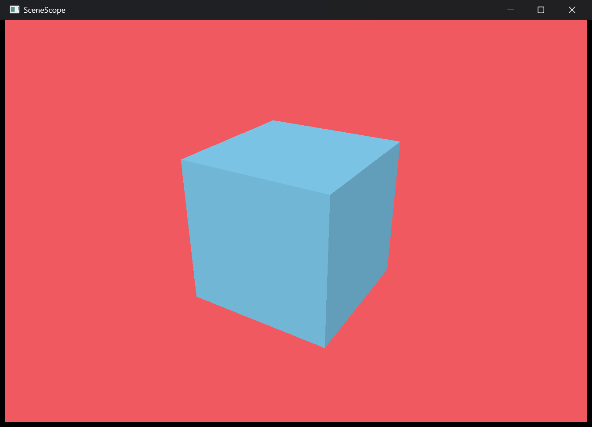

# SceneScope

> Cross-platform 3D asset inspection and validation.

基于 Rust 与 wgpu 的跨平台 3D 资产检查和验证工具。

**产品边界：SceneScope 检查资产，但不创作资产。**

## 当前状态

项目处于 **M2：从查看器到检查器**。M1 完成了固定 `Box.glb` 的解析、节点变换、Windows/Web 共享渲染、深度测试、背面剔除和轨道相机；M2-002 完成了内部 `AssetDocument`、多节点与多 primitive 遍历、UV 与内嵌 Base Color 纹理解码，并把 Windows/Web 的渲染输入统一切换到 `AssetDocument`。当前任务是接入本地文件选择（M2-003）。

唯一执行状态记录在[项目路线图](docs/roadmap.md)中。



## 快速开始

前置条件：Rust 1.87 或更高版本。

### Windows 桌面端

```powershell
cargo run -p scenescope-desktop
```

程序会加载仓库固定的 `assets/test/Box.glb`，按 **O** 可通过原生文件对话框打开任意本地 `.glb`。按住鼠标左键拖动可环绕模型，使用滚轮缩放。

### Web 端

首次构建需要安装 `wasm32-unknown-unknown` target 和 `wasm-pack`。完成前置安装后执行：

```powershell
wasm-pack build apps/web --target web --dev
python -m http.server 8080 --directory apps/web
```

然后访问 [http://127.0.0.1:8080/](http://127.0.0.1:8080/)。Web 端与桌面端使用同一份 `MeshInstance`、渲染器和相机逻辑；点击画布后用 **O** 打开浏览器文件选择器。

## 当前能力

- 将 GLB 字节解析为内部 `AssetDocument`：场景、节点层级、多个 mesh primitive、材质、纹理引用与确定性资产统计。
- 提取 `POSITION`、可选 `NORMAL`、可选 `TEXCOORD_0`、`u32` 索引、对象名称和节点 TRS 变换。
- 解码内嵌 Base Color 纹理（PNG/JPEG 统一为 RGBA8），并保留材质到纹理的引用。
- 解析失败返回分类错误：非 GLB、外部 buffer/纹理、属性数量不匹配、不支持的图像格式等。
- 使用共享 `wgpu` 渲染器在 Windows 与 Web 中显示资产；启动加载内嵌 `Box.glb`，按 **O** 可通过文件对话框打开本地 `.glb`。
- 运行时换资产：成功则替换几何与世界变换并保留相机视角；解析或上传失败、以及取消选择时，当前画面保持不变且不产生误导性诊断。
- 绘制默认场景的全部网格实例，几何按 `(mesh, primitive)` 去重后共享，世界变换按实例绑定。
- 支持深度测试、背面剔除、Lambert 漫反射、轨道相机和滚轮缩放；滚轮增量在两端按同一单位归一化（浏览器上报的像素级增量折算为「格」）。
- 使用 sRGB Surface View 保持桌面端与 Web 端的颜色输出语义一致。
- 自动化测试覆盖 Box 回归（24 顶点、36 索引、法线、世界变换）和手写 GLB fixture（可选属性缺失、UV 数量不匹配、内嵌 PNG/JPEG 解码、外部纹理拒绝）。

## 开发检查

日常开发检查会报告警告，但不会因普通 warning 中断：

```powershell
cargo check --workspace --all-targets
cargo clippy --workspace --all-targets --all-features
cargo test --workspace --all-targets
```

release 使用严格门禁。非 debug 构建会自动将所有 rustc warning 升级为 error；`release-check` 还会以 release 配置运行全量 Clippy，并把所有 Clippy warning 当作错误：

```powershell
cargo fmt --all --check
cargo release-check
cargo test --workspace --all-targets --release
cargo build --workspace --release
cargo doc --workspace --all-features --no-deps --release
```

新增 workspace crate 时必须同时：在该 crate 的 `Cargo.toml` 加入 `[lints] workspace = true`，并在 crate 根加入 `#![cfg_attr(not(debug_assertions), deny(warnings))]`。稳定版 Cargo 暂不支持按 profile 配置 `rustflags`，因此这两处不能省略。

## Workspace

```text
crates/scenescope-core    # 平台无关的内部场景数据
crates/scenescope-gltf    # GLB/glTF 适配与内部模型转换
crates/scenescope-render  # Windows/Web 共用的 wgpu 渲染器
apps/desktop              # Windows 原生入口与输入事件
apps/web                  # WebAssembly 入口与浏览器事件生命周期
assets/test               # 固定公开回归资产及许可记录
docs                      # 产品、路线图、架构、ADR 和调试记录
```

依赖边界和后续目录见[架构设计](docs/architecture.md)。项目只在出现真实消费者时增加 crate。

## v0.1 范围

- 输入单个 `.glb`，支持静态网格、索引、节点 TRS、`POSITION`、`NORMAL`、`TEXCOORD_0` 和 Base Color 纹理。
- 在 Windows 与浏览器中提供一致的场景数据和检查结果。
- 提供场景摘要、确定性规则诊断和 CLI JSON 报告。
- 首批规则：纹理尺寸、三角形预算、缺少法线、材质预算、不支持扩展。

## v0.1 不做

资产编辑/保存、格式转换、多模型格式、动画/骨骼/Morph Target/物理、Draco/KTX2、完整 PBR/阴影/后处理、ECS/完整引擎、动态插件、云端系统和主机平台均不在本期范围。

完整范围、异常语义和验收标准见[产品规格](docs/product.md)。

## 测试资产

`assets/test/Box.glb` 来自 Khronos Group 的 glTF Sample Assets，原作者/权利方为 Cesium（2017），按 CC-BY-4.0 使用。固定提交、下载地址、哈希和完整归属记录见 [资产说明](assets/test/README.md)。

## 当前限制

- 尚未支持文件拖放（见 Backlog M2-006），每次打开本地文件需要通过 O 键重新选择。
- 渲染器尚未消费 UV 与 Base Color 纹理；材质信息目前只用于解析与统计（见 M2-010）。
- 尚无场景摘要 UI、资产统计界面、检查规则、CLI 或 JSON 报告。
- 不支持动画、蒙皮、Morph Target、Draco、KTX2、外部 buffer；纹理仅接受 BIN 内嵌的 PNG/JPEG。
- 当前只验证了 Windows 桌面端和浏览器中的 WebAssembly 构建与运行，不能据此声称其他平台已受支持。

## 已知问题

- 当前固定方向光会让背向光源的一侧明显变暗，这不是背面剔除错误。
- Windows 入口目前使用持续重绘，静止时仍会占用额外 CPU/GPU 时间。
- 加载或 GPU 初始化失败时尚无用户界面，Web 端错误只写入浏览器控制台。
- 内嵌图像缺失 mimeType 时，`gltf` 依赖会在解析内部 panic；错误分类计划在 M2-005 处理。

## 文档索引

- [产品规格](docs/product.md)
- [项目路线图](docs/roadmap.md)
- [架构设计](docs/architecture.md)
- [ADR-0001：项目基线](docs/adr/0001-project-foundation.md)
- [ADR-0002：跨平台颜色输出](docs/adr/0002-cross-platform-color-output.md)
- [ADR-0003：资产文档作为唯一渲染输入](docs/adr/0003-asset-document-render-input.md)
- [ADR-0004：GUI 框架与界面分层](docs/adr/0004-gui-framework-and-ui-layering.md)
- [调试记录：Desktop/Web 色差](docs/debugging/0001-desktop-web-color-difference.md)
- [glTF/GLB 格式布局图](docs/images/gltf-layout.svg)
